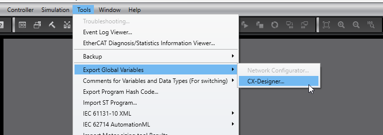
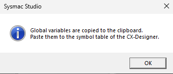
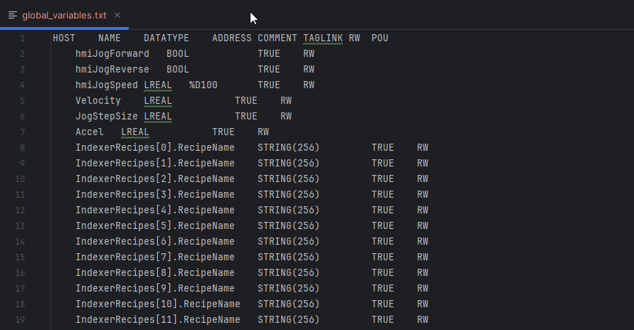

# Omron Sysmac Simulator Driver

This project is a Python library that enables communication with the Sysmac Studio simulator using the NexSocket.dll installed with the Omron IDE. It can be used to exercise and unit test PLC projects in the simulator without the need to connect actual hardware. The main methods are similar to the [APHYT](https://github.com/aphyt/aphytcomm) Ethernet/IP project used for real Sysmac hardware on the network, so code can be reused to test both simulated and real systems. There are some limitations on simulated systems because the NexSocket.dll does not provide as much data as Ethernet/IP.

This code modifies and expands a GPL3 module released by [Simumatik](https://github.com/Simumatik) Digital Twin platform and the modifications:

- Allow it to be used as a stand-alone Python interface to the Simulator
- Variables can be assigned PLC data types in order to implicitly format the bytes during read and write operations
- Can import a text file created by pasting the results of Sysmac Studio's "Export Global Variables" in order to define the data types of PLC variables automatically

# Creating an Import File of Published Global Variables

Begin by exporting a formatted list of published global variables by navigating Sysmac Studio's menu structure to: Tools - Export Global Variables - CX-Designer 



This should result in a dialog that alerts the user that the data has been copied to the clipboard



Paste the results into a text file and save it in a location accessible to the Python code. The result should look something like this below:



The file "global_variables.txt", created using this process, is used in the example code below.

# Example
The following code will connect to the running simulator
```python
from omron_sysmac_simulator import *
import time

sim_driver = SysmacSimulator()
sim_driver.connect()
sim_driver.populate_from_file('global_variables.txt')

var_name = "hmiPositionTarget"
for i in range(5):
    print(sim_driver.read_variable(var_name))
    time.sleep(1)
    sim_driver.write_variable(var_name, 12.34)
    print(sim_driver.read_variable(var_name))
    time.sleep(1)
    sim_driver.write_variable(var_name, 0.0)

sim_driver.disconnect()
```
